# C1 Classroom Comfort

**Classroom sensors + student QR feedback → one staff dashboard that says when a room needs checking.**

Group C1 · XJTLU **IOT001TC** Introduction to AIoT · Smart Campus & Student Life
*How might we use classroom sensors and student feedback to help staff improve classroom comfort?*

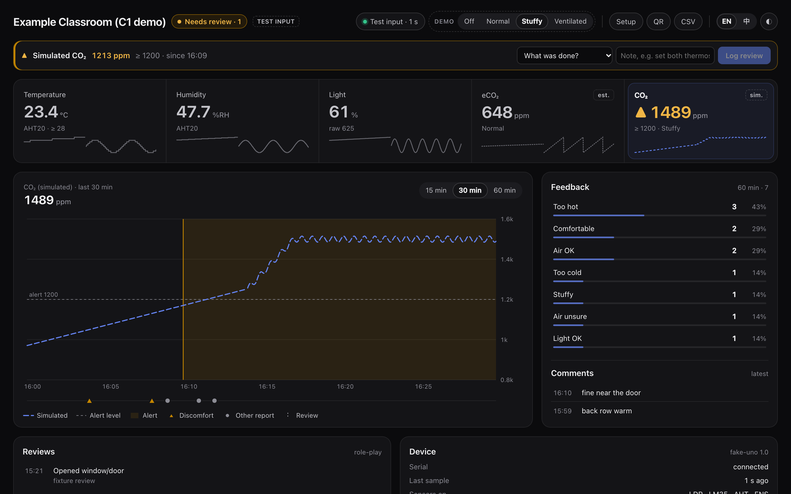

> Student prototype for one example classroom. It is not an official campus service or a safety monitor, and it does not control the air-conditioning.
> **The screenshots use the fake-UNO test generator** (note the `TEST INPUT` chip). Real-hardware results are recorded in [docs/TEST_REPORT.md](docs/TEST_REPORT.md) as they happen.

---

## The 30-second version

1. **Sense:** an Arduino UNO reads light, temperature, humidity and a gas-sensor estimate every 2 seconds.
2. **Connect:** it sends one line of data over USB to a laptop.
3. **Students speak up:** they scan a QR code in the room and tap their answers (too hot / stuffy / too dark…) in under a minute.
4. **Analyse:** the laptop app checks that data is fresh, then applies simple, explainable rules.
5. **Show:** the dashboard shows readings and feedback together, and one badge answers *"does this room need checking?"*
6. **Act:** a person checks the room and logs what they actually did. The dashboard keeps watching until things are back to normal.
   - In our classrooms that usually means one of: adjusting one of the room's several thermostats, asking the teacher, reporting it to facilities, or opening a window.

## How it works

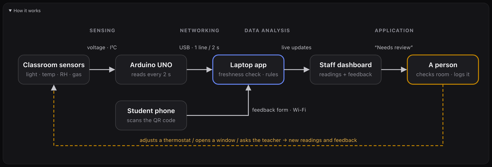

| Layer (module terms, Ch1) | In C1 |
|---|---|
| **Sensing** | Photoresistor (A1), LM35DZ temperature (A0), ENS160 + AHT21 module (I²C) on an Arduino UNO R3 |
| **Networking** | USB serial cable (UNO → laptop); local Wi-Fi or a phone hotspot (student phones → laptop) |
| **Data analysis** | Node.js app: validates every serial line, marks data stale after 10 s, runs threshold rules with hysteresis |
| **Application** | Staff dashboard, "Needs review" prompt, review log, QR feedback form |

System diagram for reports: [docs/wiring/system-overview.svg](docs/wiring/system-overview.svg)

### Why no AI?

One classroom, a few weeks of data, and staff need to understand *why* they are being asked to check a room. A rule like *"simulated CO₂ ≥ 1200 ppm for 2 readings in a row"* is transparent and testable, and needs no training data. The course itself calls fixed rules "IoT, not necessarily AIoT" (Ch1 p.28–29). A person stays in the loop for every action.

## Screens

**Students:** scan the QR code and answer in a few taps, in English or Chinese.

<p align="center">
  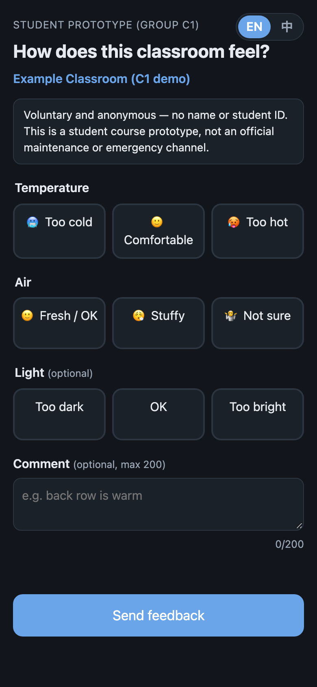
  &nbsp;&nbsp;
  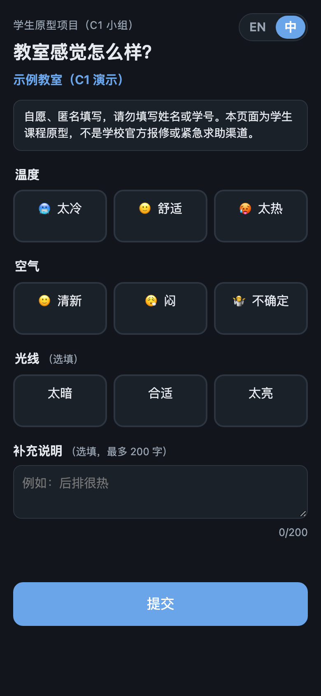
  &nbsp;&nbsp;
  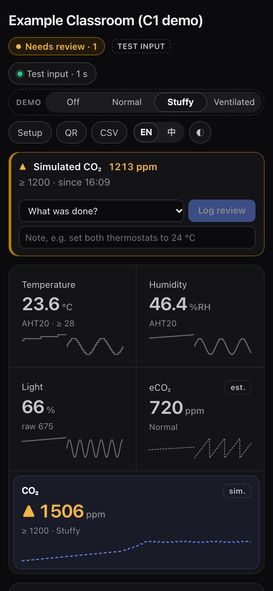
</p>
<p align="center"><sub>Feedback form (EN) · Feedback form (中文) · Dashboard on a phone</sub></p>

**Staff:** the whole dashboard switches language with the EN / 中 button.

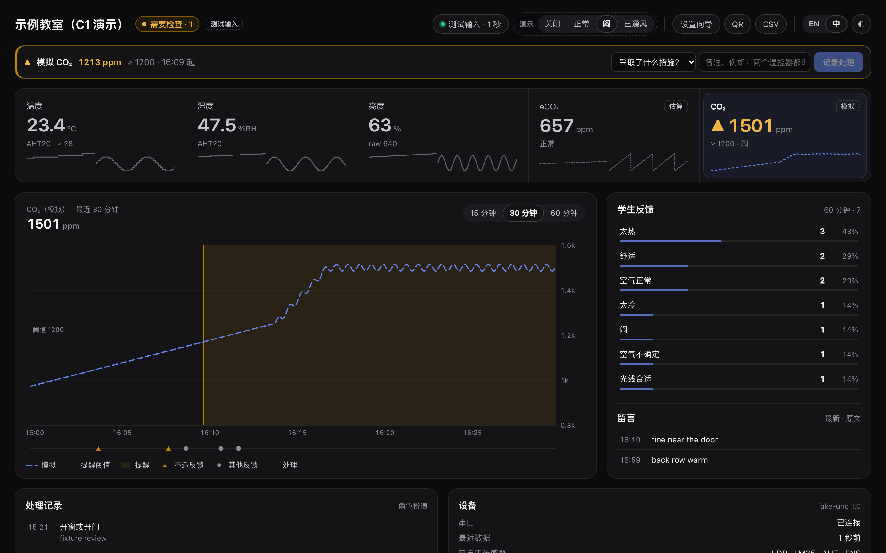

<details>
<summary><b>More screens</b>: light theme, QR pop-up, hardware setup page</summary>

<br>

**Light theme**

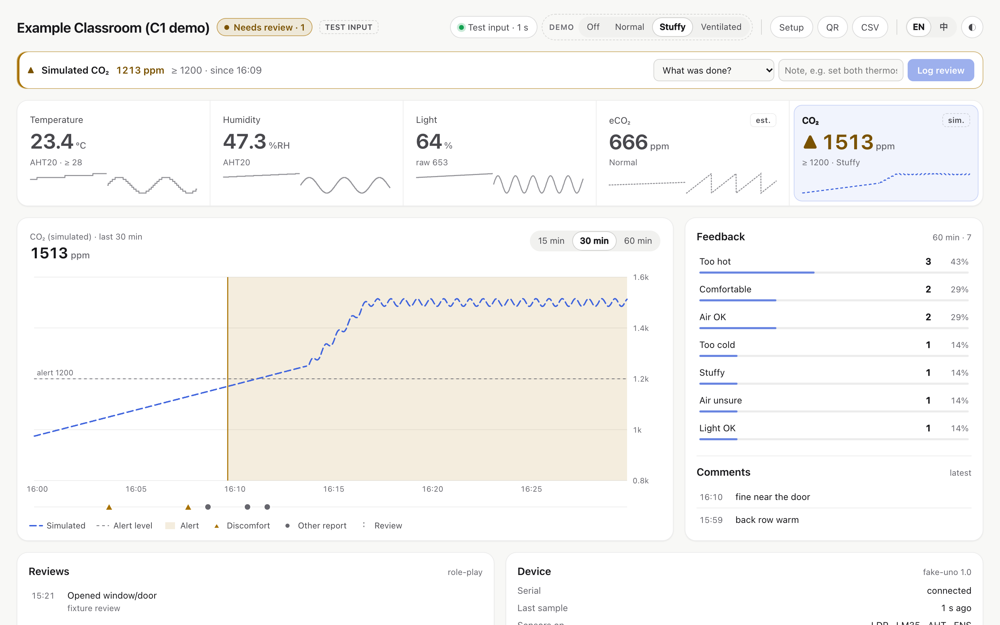

**QR pop-up**: shows only addresses a phone can actually reach

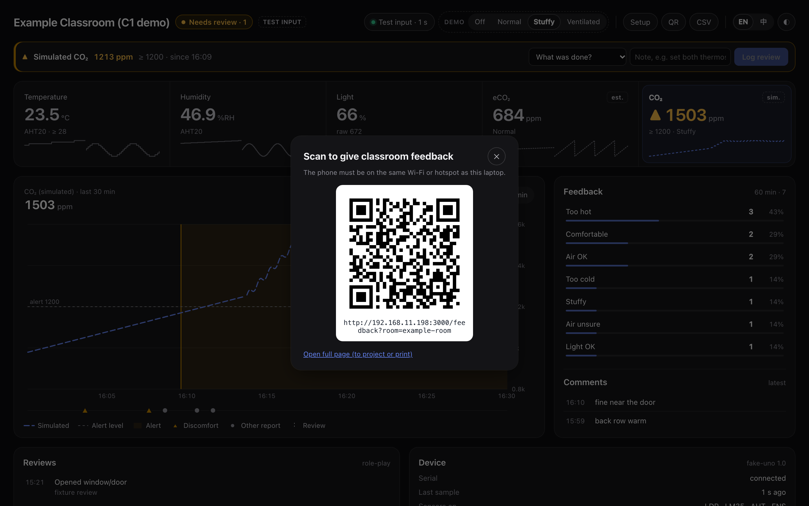

**Hardware setup page**: a live checklist for Monday; each step turns green only from real data

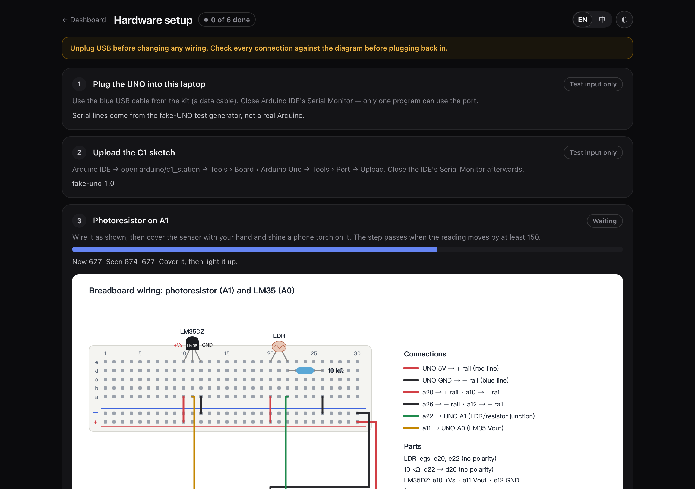

</details>

## Honest data labels

Every value says what kind of number it is, and the app never fills gaps with fake data.

| Badge | Meaning | Example |
|---|---|---|
| *(no chip)* | **Measured** by a real sensor | Temperature from the AHT21 or LM35 |
| `est.` + dotted line | A sensor's **estimate** | ENS160 eCO₂: a gas-sensor estimate, **not measured CO₂**, and never used for alerts |
| `sim.` + dashed line | **Simulated** demo values | "CO₂ (simulated)", which drives the alert demo |
| `stale 12 s` | No fresh reading | USB unplugged → values grey out instead of pretending to be live |
| "No data" band | A gap in the history | Shaded on the chart, never joined up |

## Hardware

Parts from the Keyestudio **KS0069** kit, plus one purchased module:

- Arduino UNO R3 (Keyestudio), USB cable, 830-hole breadboard, jumper wires
- Photoresistor + 10 kΩ resistor → **A1** (relative light, not lux)
- LM35DZ temperature sensor → **A0**
- ENS160 + AHT21 module (Mingwu) → **I²C A4/A5**, used only after the voltage checks in the hardware guide

**Breadboard wiring:** each wire ends on a tagged UNO pin (5V, GND, A0, A1)

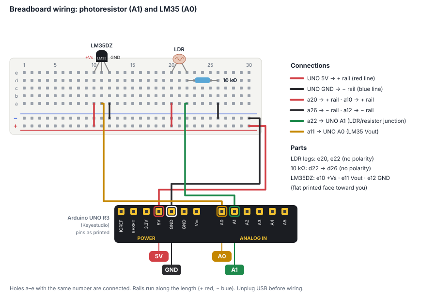

**Circuits**

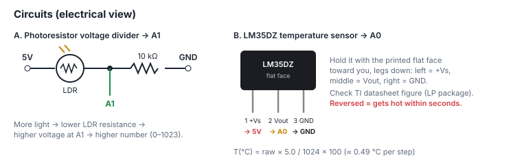

**ENS160 + AHT21 module** (only after the voltage checks)

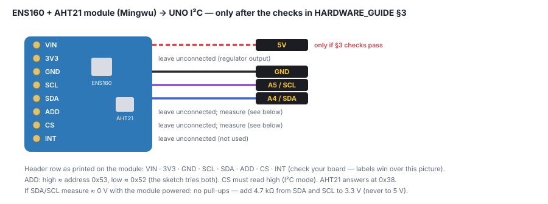

Full guide with safety, soldering and multimeter checks: [docs/HARDWARE_GUIDE.md](docs/HARDWARE_GUIDE.md)

## Evidence behind the design

- **Survey** (51 recorded responses, convenience sample, Oct 2026; percentages use all 51 responses, blanks included):
  - **27/51** wanted improvements but had not reported them.
  - **28/51** did not know whom to contact.
  - The QR code was the most popular way to report (**19/51**), though not a majority.
  - **37/51** would spend up to one minute giving feedback.
  - **What we built from this:** a short QR form, and a dashboard that tells staff, not students, who should act.
- **TrojanSense** (Konis et al., 2020): show occupants' comfort feedback next to room readings.
- **Rawat et al.** (2025): quiet visual alerts with a named person who acts; don't rely on CO₂ alone.

We read the papers' abstracts and introductions. Details are in Artifact 3 (the evidence matrix).

## Run it yourself (optional)

You don't need to. The screenshots show everything. But if you want to:

```bash
cd app
npm install
npm run demo   # no hardware: clearly labelled simulated sensors
npm start      # with the Arduino plugged in
```

Then open:

| Page | Address |
|---|---|
| Dashboard | http://localhost:3000 |
| Hardware setup | http://localhost:3000/setup |

Students scan the QR code from the dashboard's **QR** button. More detail: [docs/USER_GUIDE.md](docs/USER_GUIDE.md).

## Status

| Part | Status |
|---|---|
| Laptop app, dashboard, QR form, rules, review log, EN/中文 | ✅ Built; **22 automated tests pass**; QA at phone, laptop and ultrawide widths, light + dark |
| Arduino sketches | ✅ Compile for the UNO (24% flash with all sensors) · ⏳ not yet run on the real board |
| Photoresistor, LM35 | ⏳ Wiring on Monday (Tinkercad simulation of the photoresistor: 54 → 974) |
| ENS160 + AHT21 module | 💳 Paid, ⏳ awaiting delivery, soldering and voltage checks |
| QR from a separate phone | ⏳ Not tested yet |

## What's where

| Folder | Contents |
|---|---|
| [`app/`](app) | Laptop app: serial bridge, dashboard, feedback form, setup page, tests, tools (fake UNO, screenshots, wiring diagrams) |
| [`arduino/`](arduino) | `serial_check` (step 0), `c1_station` (main sketch), `i2c_scanner` |
| [`docs/`](docs) | [Hardware guide](docs/HARDWARE_GUIDE.md) · [User guide](docs/USER_GUIDE.md) · [Serial format](docs/SERIAL_PROTOCOL.md) · [Test report](docs/TEST_REPORT.md) · [Dashboard spec](docs/DASHBOARD_SPEC.md) · [Group video outline](docs/GROUP_VIDEO_OUTLINE.md) · [Individual report guide](docs/INDIVIDUAL_REPORT_GUIDE.md) · [AI use record](docs/AI_USE_RECORD.md) · [Course notes](docs/COURSE_MATERIALS_NOTES.md) |

## Deadlines

| What | Due |
|---|---|
| Artifact 4: Initial prototype / draft (`Group C1_First Draft`) | **Sun 15 Nov, 23:59** |
| Individual report (65%) + group video (35%) + peer assessment | **Sun 13 Dec, 23:59 Beijing time** |

## AI use

The software, sketches, diagrams and docs in this repository were written with Claude (Anthropic) from 4 Nov 2026, directed and checked by the group. What was AI-generated, and what the group verified, is recorded in [docs/AI_USE_RECORD.md](docs/AI_USE_RECORD.md).
